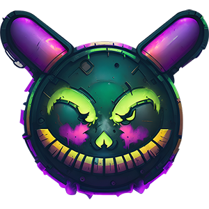
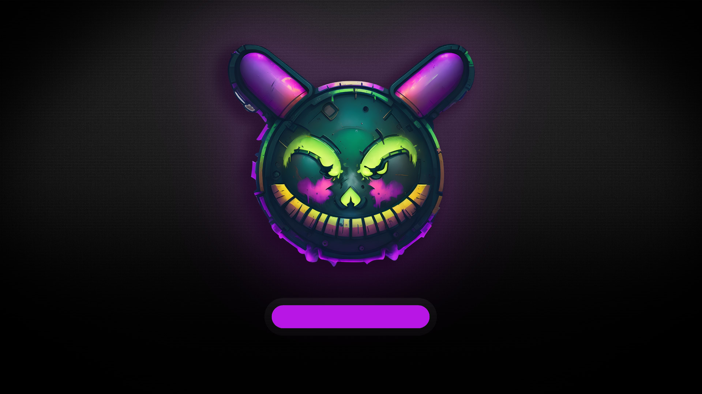
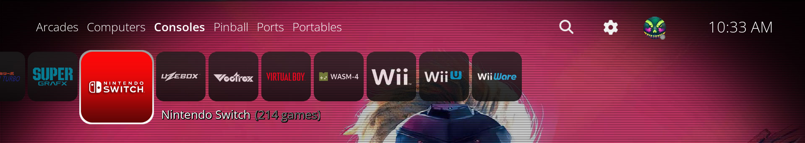
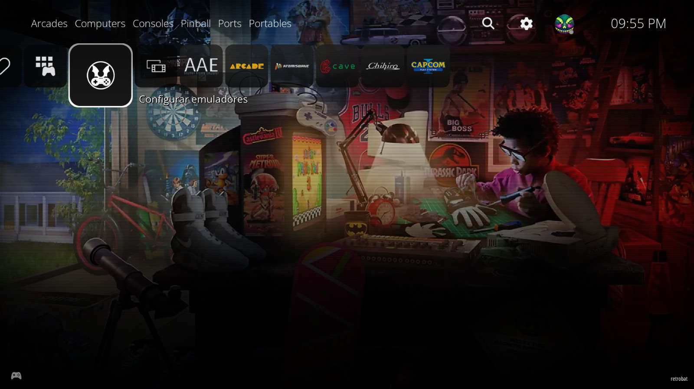
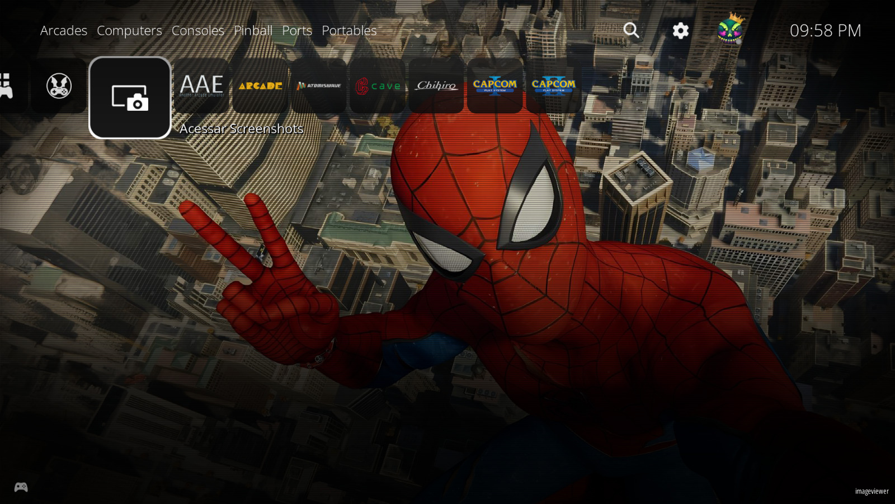
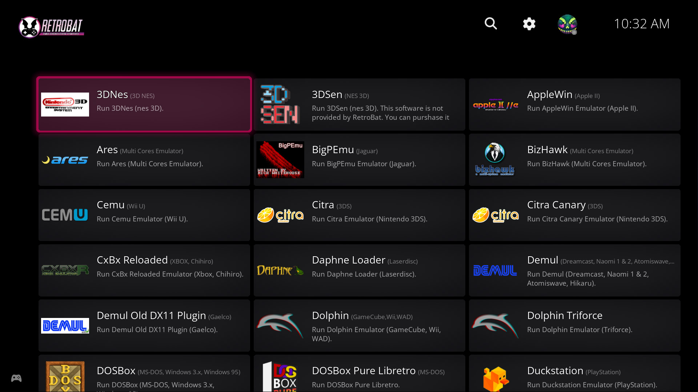
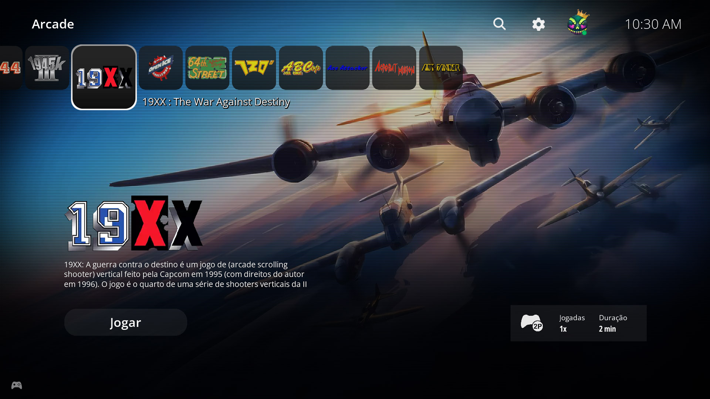

# RIESCADE Platforms — ES-X adaptation (TEST)

**A PlayStation 5-inspired theme adapted for [EmulationStation-X (ES-X)](https://github.com/Renetrox/EmulationStation-X) and RetroPie.**

**Original theme:** [RIESCADE Platforms](https://github.com/marcoriesco/riescade_platform), v1.2 (5 February 2024), by **MarcoRiesco**.  
**ES-X adaptation:** **Renetrox**. This is a community adaptation, not an official upstream release.

The objective is to preserve the original RIESCADE artwork, layout and PS5-inspired presentation while using **native ES-X theme features**. The adaptation deliberately avoids importing Batocera's conditional-expression engine or replacing the RetroPie frontend.

> **Status — experimental:** Core carousel and artwork layouts have been adapted, but system-category classification and spacing still require testing across systems and screen sizes. This theme requires a recent ES-X build; it is **not** a drop-in replacement for the original Batocera theme on classic EmulationStation.

## ES-X features

- **System carousel:** horizontal platform logos, original RIESCADE positioning, selection frame and system-specific background artwork.
- **Seven system-category tabs:** **Arcades, Computers, Consoles, Extensions, Pinball, Ports and Portables**. The active tab changes its text color and font based on ES-X's native `activeFor`, `activeColor` and `activeFontPath` support.
- **Game-list carousel:** horizontal artwork carousel using ES-X's native `TextListComponent`, with a fixed artwork box, spacing controls, selected-game emphasis and the original navigation sound.
- **Selected-game details:** game title, description, marquee, video artwork, release year, play count and player-count badge.
- **Dynamic player badges:** the `md_players_icon` image uses `{game:players}` with the included `resources/systemicons/` artwork (for example `1p.png`, `2p.png`, `3p.png`, `4p.png`, `8p.png`). Unsupported values fall back to the controller icon.
- **Fallback system logos:** ES-X can show a system-name text fallback when a platform-specific logo is unavailable.
- **Original visual assets:** fanart, overlays, fonts, logo frames, header icons and the supplied splash resources are retained.

The adaptation combines the original RIESCADE visual geometry with the ES-X-native carousel approach. There is **no requirement for Batocera-only `if` expressions, `stackpanel`, `storyboard`, `onclick` or `theme.ini`**.

## Install on ES-X / RetroPie

Install a recent version of [EmulationStation-X](https://github.com/Renetrox/EmulationStation-X) first. From a terminal on your RetroPie system:

```bash
mkdir -p ~/.emulationstation/themes
git clone https://github.com/Renetrox/riescade-esx.git \
  ~/.emulationstation/themes/riescade-esx
```

Then open ES-X's theme settings and select **riescade-esx**. To update the theme later:

```bash
git -C ~/.emulationstation/themes/riescade-esx pull --ff-only
```

You can also install the theme through the ES-X Theme Browser if it is listed in your configured theme catalog.

### Media and system metadata

The appearance depends on your installed games and metadata:

- Add images, thumbnails, **wheel** artwork, marquees and videos to the game metadata. The horizontal game carousel is configured to use **wheel** artwork and falls back to the included generic image.
- Player badges reflect the game's `players` metadata; release year and play count likewise depend on populated metadata.
- System fanart and logos are resolved using `${system.theme}`. Missing resources use the theme's built-in fallbacks.
- Category highlighting uses the system's name, supported platform IDs and, where available, the optional `systemHardwareType` theme variable. Unknown systems retain the normal tab style instead of being assigned an invented category.

Recent ES-X builds also include a **native metadata file picker**, making it possible to browse for artwork and videos with a controller. That picker belongs to **ES-X**, not to this theme.

## Known limitations and compatibility

- **Category tabs are a TEST feature.** Highlighting is implemented with native ES-X text properties; not every custom system can be classified automatically.
- The large **Play** button is **visual only**. Launch games using the usual **A / Enter** control.
- Batocera-specific total-playtime bindings are not exposed by this ES-X theme. The information card uses available metadata instead: **players, play count and release year**.
- `splash.xml` and `gamesplash.xml` are included as theme resources. Their use depends on the ES-X build and should not be mistaken for full Batocera splash-screen compatibility.
- Some layout details are still being refined for different resolutions and ARM devices, including Orange Pi 4A.
- Classic EmulationStation and Batocera are **not** the target for this ES-X-specific version. Use the [original RIESCADE theme](https://github.com/marcoriesco/riescade_platform) for its original platform support.

For additional adaptation notes, see [README-ESX.txt](./README-ESX.txt).

## Screenshots and visual references

The images below come from the original RIESCADE theme and are retained as **visual references**. They do not guarantee that every Batocera layout or feature is present in this ES-X test version.













## Credits and licensing

**Original theme and design:** [MarcoRiesco / RIESCADE Platforms](https://github.com/marcoriesco/riescade_platform).  
**Adaptation for ES-X:** [Renetrox](https://github.com/Renetrox).

The original author's README permits sharing and modification with **attribution**, identification of modifications and preservation of applicable terms, and states **no commercial distribution**. The upstream repository also includes a GPL-3.0 `LICENSE` file. These notices should be read together rather than assuming the GPL license automatically covers third-party images, logos or other artwork.

- Logos and trademarks remain the property of their respective owners.
- The original theme's notice restricts the use of its Midjourney backgrounds to that template.
- [Google Fonts — Open Sans](https://fonts.google.com/specimen/Open+Sans)
- [Arcade CoinOps backgrounds](https://discord.com/invite/q7uaBDM6GS) (original credits: modified to 16:9)
- [AlekFull backgrounds](https://github.com/fagnerpc)
- [Retrobat Emulators Template](https://github.com/fabricecaruso/es-theme-carbon)

**This ES-X edition is an adaptation, not a claim of ownership of the original RIESCADE artwork.**
